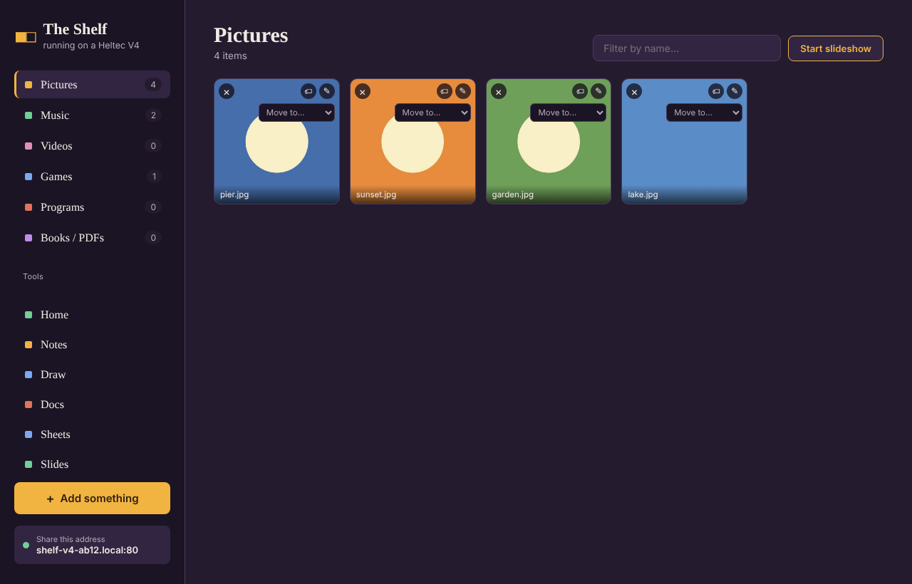
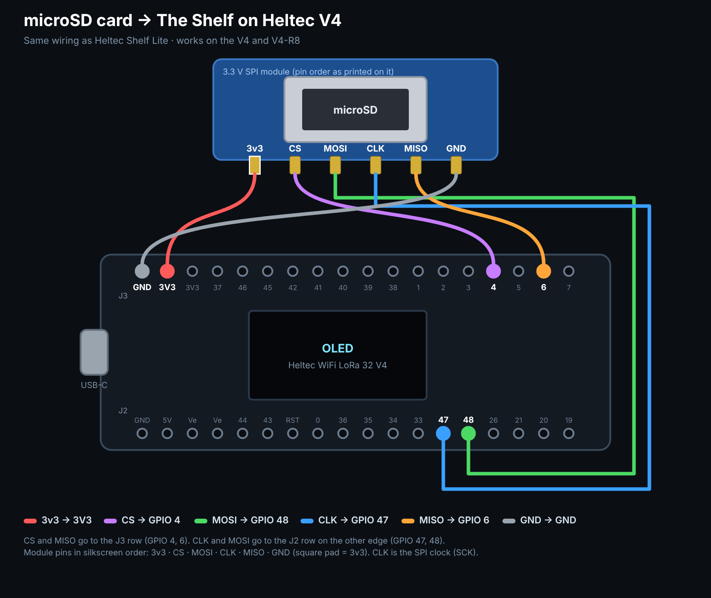

# The Shelf for Heltec V4

**[The Shelf](https://github.com/hardwaremack-prog/the-shelf), running on a Heltec WiFi LoRa 32 V4.** The board serves The Shelf's own web app (the same page you get on a PC or a Pi), with your files on a microSD card. Anyone on your home Wi-Fi opens it in a browser, and it shows up in Messages on every other Shelf in the house.

### ➡️ Install from your browser: **https://hardwaremack-prog.github.io/The-Shelf-Heltec-V4/**



> Installing replaces Meshtastic on that board. You can put Meshtastic back any time from [flasher.meshtastic.org](https://flasher.meshtastic.org).

## What works on the board

| ✅ Included | 💻 Needs The Shelf on a computer |
|---|---|
| Pictures (grid, slideshow, photo editor), Music (shuffle, play counts, artist and cover art read from your MP3s' own tags), Videos, Games (`.html` and zipped HTML games play in the page), Programs, Books (PDF reader and cover thumbnails) | The AI assistant and Create with AI |
| Home: bulletin board with notes, pasted pictures and videos, quick links, weather | Remote desktop (VNC) |
| Notes, Docs, Sheets, Slides, Draw | Online album-art lookup, tag editing, Standardize names, Remove duplicates, Export |
| Tidy Suite | Big Transfer, backup/restore zips, spreadsheet import |
| **Messages**: finds and chats with your other Shelves (PCs, Pis, other boards), pictures included | Accounts and passwords |
| Visitors | |

The buttons for those computer-only features are hidden on the board, and the AI and Big Transfer tabs are left out.

## Hardware

| Part | Notes |
|---|---|
| Heltec WiFi LoRa 32 **V4** | The standard V4 (ESP32-S3R2, 2 MB PSRAM), or the V4-R8 (8 MB PSRAM). Each has its own install button |
| 3.3 V SPI microSD module | Same module and wiring as [Heltec Shelf Lite](https://github.com/hardwaremack-prog/Heltec-Shelf-Lite--Wifi-Thumbdrive) |
| microSD card | FAT32. A 32 GB card works out of the box |



| microSD module | Heltec V4 |
|---|---|
| VCC | **3V3** |
| GND | GND |
| CS | GPIO 4 |
| MISO | GPIO 6 |
| CLK (SCK) | GPIO 47 |
| MOSI | GPIO 48 |

With no card, The Shelf keeps files in about 10 MB of the board's own flash. The screen shows **SD** or **FLASH** in the corner.

### On the card

Your shelves are normal folders at the top of the card: `Pictures`, `Music`, `Videos`, `Games`, `Programs`, `Books`. Pop the card into a computer and copy music or photos straight in. Put files directly in those folders, because subfolders inside a shelf aren't shown (the same as The Shelf). Notes, docs, drawings, play counts, thumbnails and messages live in the hidden `.shelf` folder.

## First-time setup

1. Install with the [web installer](https://hardwaremack-prog.github.io/The-Shelf-Heltec-V4/) (Chrome or Edge).
2. Power the board. The screen shows **Join The-Shelf-XXXX**. Join it from your phone with the password **`theshelf`**.
3. The setup page opens (or go to `http://192.168.4.1`). Tap **Find networks**, pick your Wi-Fi and enter its password.
4. Back on your home Wi-Fi, open the address on the screen, or **`http://shelf-v4-xxxx.local`**.

The **Heltec V4** card at the bottom of The Shelf's sidebar opens the board's settings page (`/board/`). There you can change Wi-Fi, rename the board, see storage, and restart it. Hold **PRG** for 6 seconds to forget the Wi-Fi.

## Messages between Shelves

The board talks to other Shelves the same way they talk to each other: `shelf-presence` broadcasts on UDP port 41234, a network scan that asks every address on port 8080 "are you a Shelf?", and direct HTTP for messages. That's why the board answers on **port 8080** as well as port 80. Click the board in another Shelf's Messages list to chat, or choose **Connect Shelf** to open it.

## Good to know

- **There's no login.** Anyone on your home Wi-Fi can view and change things, the same as Heltec Shelf Lite. Don't put it on a guest network you share.
- Expect roughly 0.5–1 MB/s through the SPI card. Songs, photos, documents and games are quick; big videos are slow to upload.
- Weather needs the browser to share its location. Browsers only allow that on `https` or `localhost` pages, so on the board it usually stays hidden, the same as The Shelf does on a LAN.

## Building

`build.sh` packs The Shelf's current `public/` folder (cloned from [the-shelf](https://github.com/hardwaremack-prog/the-shelf), or set `SHELF=/path/to/the-shelf`) into a LittleFS image, compiles the firmware for both V4 versions, and writes full images to `docs/firmware/`.

Needs:
- arduino-cli with **esp32 core 2.0.17**
- **ESPAsyncWebServer 3.3.23** + **AsyncTCP 3.2.14** (mathieucarbou), **ArduinoJson 7**, **U8g2**
- **mklittlefs 3.x** built with `LFS_NAME_MAX=64` to match the board. The copy bundled with the 2.0.x core breaks on paths over 32 characters (`make CPPFLAGS="-D LFS_NAME_MAX=64"`, or edit its Makefile)

`tools/pack_www.py` makes a few changes to The Shelf's page for the board:
- removes the AI and Big Transfer tabs
- adds `board-ui/board.css`, which hides computer-only buttons
- adds `board-ui/board.js`, which shows the board card and its address

Rebuild after updating The Shelf to pick up its newest page.

### Layout

```
ShelfV4/
  main.cpp         Wi-Fi + setup mode, storage, web servers (80 and 8080), screen, button
  api_files.cpp    the six shelves: list, upload, rename, move, delete, play counts,
                   thumbnails, photo editor, zipped games, Range-capable file serving
  api_tools.cpp    Home board, Notes/Docs/Slides/Sheets, Draw, Visitors, weather, settings
  messaging.cpp    Shelf-to-Shelf discovery and chat
  music_meta.cpp   artist, title and cover art from ID3 tags
  util.cpp         JSON bodies (spooled to the card when big), streaming responses
board-ui/          the board's settings page and the small additions to The Shelf's page
tools/pack_www.py  builds the web app image
docs/              web installer (GitHub Pages) and firmware
```

Flash layout (16 MB): 3 MB app, 2 MB web app (LittleFS), about 10.9 MB storage for when no card is fitted.
