# The Shelf for Heltec V4 (and V3, and plain ESP32 boards)

**[The Shelf](https://github.com/hardwaremack-prog/the-shelf), running on a Heltec WiFi LoRa 32 V4, a V3, or a plain ESP32 dev board (NodeMCU-32S / DevKitC).** The board serves The Shelf's own web app (the same page you get on a PC or a Pi), with your files on a microSD card. Anyone on your home Wi-Fi opens it in a browser, and it shows up in Messages on every other Shelf in the house.

### ➡️ Install from your browser: **https://hardwaremack-prog.github.io/The-Shelf-Heltec-V4900mhzMesh/**


> Installing replaces Meshtastic on that board. You can put Meshtastic back any time from [flasher.meshtastic.org](https://flasher.meshtastic.org).

## What works on the board

| ✅ Included | 💻 Needs The Shelf on a computer |
|---|---|
| Pictures (grid, slideshow, photo editor), Music (shuffle, play counts, artist and cover art read from your MP3s' own tags), **MIDI** (its own shelf: `.mid`, `.midi`, `.kar` files played by a built-in General MIDI synth, with the same player, shuffle and play counts), Videos, Games (`.html` and zipped HTML games play in the page), Programs, Books (PDF reader and cover thumbnails) | The AI assistant and Create with AI |
| Home: bulletin board with notes, pasted pictures and videos, quick links, weather | Remote desktop (VNC) |
| Notes, Docs, Sheets, Slides, Draw | Online album-art lookup, tag editing, Standardize names, Remove duplicates, Export |
| Tidy Suite | Big Transfer, backup/restore zips, spreadsheet import |
| **Messages**: finds and chats with your other Shelves (PCs, Pis, other boards), pictures included | User accounts (the board has one admin password instead) |
| **900MHz Coms**: LoRa text mesh between boards, every board a relay, 12-hour catch-up, list of boards and remote admin | |
| **Read-only mode** with an admin password to unlock changes | |

The buttons for those computer-only features are hidden on the board, and the AI and Big Transfer tabs are left out.

## Hardware

| Part | Notes |
|---|---|
| Heltec WiFi LoRa 32 **V4** or **V3** | The standard V4 (ESP32-S3R2, 2 MB PSRAM), the V4-R8 (8 MB PSRAM), or the V3 (8 MB flash, no PSRAM). Each has its own install button |
| 3.3 V SPI microSD module | The small blue 6-pin module whose pins read **3v3 · CS · MOSI · CLK · MISO · GND** (square pad = 3v3). It has no voltage regulator, so it goes to **3V3**, never 5V |
| microSD card | FAT32. A 32 GB card works out of the box |

### Wiring the microSD card (V4 and V3)

From **v1.6.0** the card uses four neighbouring pins on the J3 row, the same layout as Heltec V4 MP3 + BT:


| microSD module | Heltec V4 / V3 |
|---|---|
| 3v3 | **3V3** |
| GND | GND |
| CS | GPIO 42 |
| MOSI | GPIO 41 |
| CLK (SCK) | GPIO 40 |
| MISO | GPIO 39 |

The V3's J3 row is laid out the same way ([V3 diagram](docs/sd-wiring-shelf-v3.png)). On a V4, GPIO 39–42 are shared with the GNSS connector, so **leave the GNSS kit unplugged**.

**Easier: plug it straight in.** CS · MOSI · CLK · MISO sit on 42 · 41 · 40 · 39 in the same order as the module's pins, so the module plugs straight into the header. Bend up (or clip) its 3v3 and GND pins so they skip GPIO 45 and 38, then add two short jumpers to the GND and 3V3 pins at the start of the row.

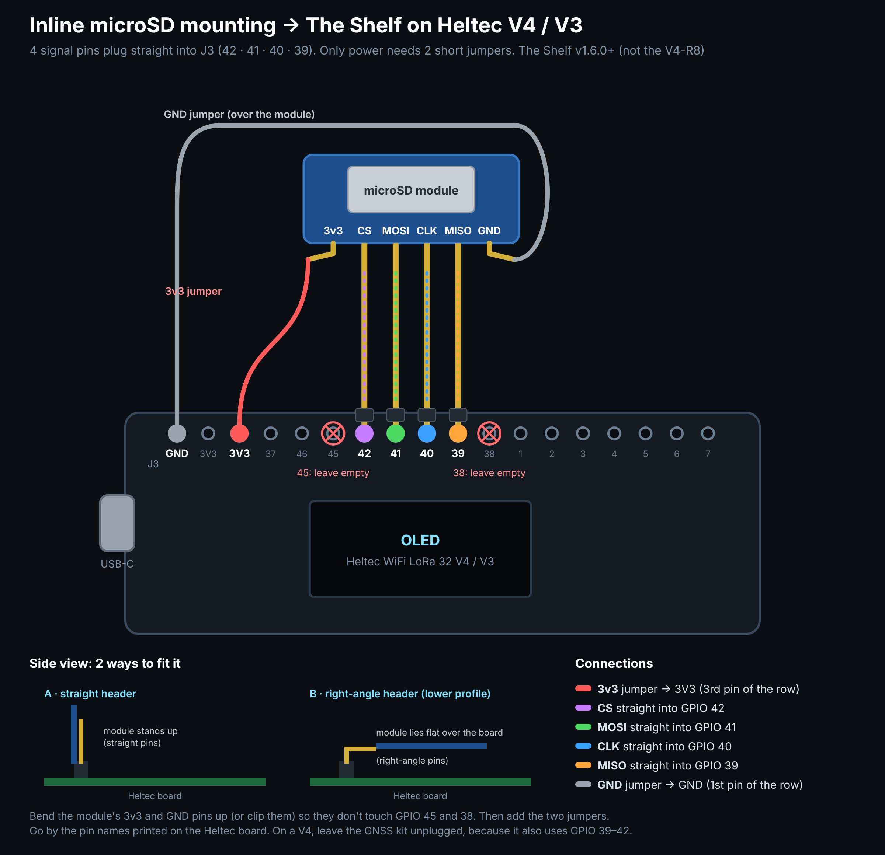

**Heltec V4-R8:** its GPIO 40 switches the screen's power, so the R8 build keeps the older layout: CS 4, MISO 6, CLK 47, MOSI 48 ([R8 diagram](docs/sd-wiring-shelf-v4-r8.png)).

> **Upgrading from v1.5 or earlier on a V4 or V3?** The card moved from CS 4 · MISO 6 · CLK 47 · MOSI 48 to the pins above. Move the four signal wires, or the board won't find the card and will use its own flash instead.

With no card, The Shelf keeps files in the board's own flash: about 9 MB on a V4, about 2.5 MB on a V3. The screen shows **SD** or **FLASH** in the corner.

### On a Heltec V3

The V3 gets the same Shelf, the same tabs and the same 900MHz Coms. Its mesh settings match the V4's, so **V3 and V4 boards are on one mesh**, relaying and catching each other up. The differences:

- **Transmit power.** The V3 has no front-end amplifier, so its levels are Low ~11, Normal ~17 and High ~22 dBm (the V4 reaches ~27). The tab shows the right numbers for each board.
- **Memory.** The V3 has no PSRAM, so it keeps the newest 150 Coms messages on screen (the V4 keeps 300). The full log stays on the card. Give it a little longer with lots of people browsing at once.
- **Storage without a card** is about 2.5 MB, so fit a microSD card.
- **Screen** says **V3** in the top bar, and its address is `shelf-v3-xxxx.local`.

### On the card

Your shelves are normal folders at the top of the card: `Pictures`, `Music`, `MIDI`, `Videos`, `Games`, `Programs`, `Books`. Pop the card into a computer and copy music or photos straight in. Put files directly in those folders, because subfolders inside a shelf aren't shown (the same as The Shelf). Notes, docs, drawings, play counts, thumbnails and messages live in the hidden `.shelf` folder.

## First-time setup

1. Install with the [web installer](https://hardwaremack-prog.github.io/The-Shelf-Heltec-V4900mhzMesh/) (Chrome or Edge).
2. Power the board. The screen shows **Join The-Shelf-XXXX**. Join it from your phone with the password **`theshelf`**.
3. The setup page opens (or go to `http://192.168.4.1`). Tap **Find networks**, pick your Wi-Fi and enter its password.
4. Back on your home Wi-Fi, open the address on the screen, or **`http://shelf-v4-xxxx.local`**.

### 900MHz Coms (LoRa mesh between boards)

A **900MHz Coms** tab in The Shelf's Tools lets Shelf boards (V4 and V3) text each other over their LoRa radios, with no Wi-Fi or internet between them.

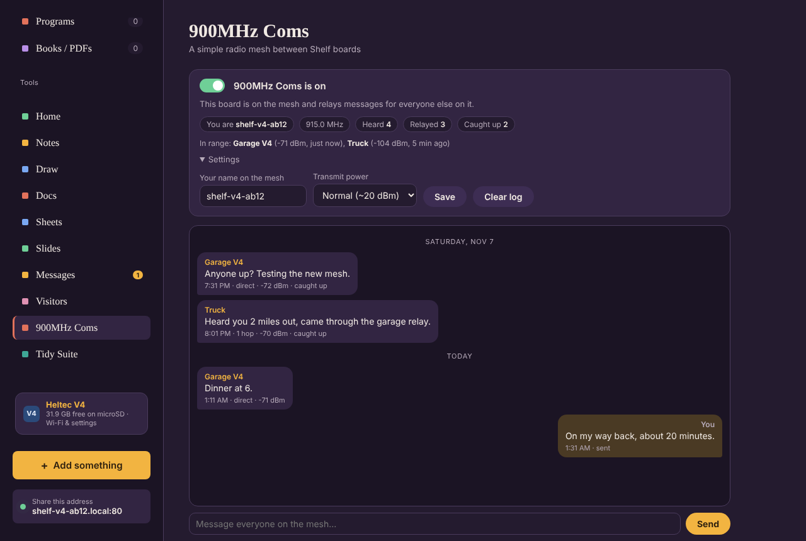

<p align="center">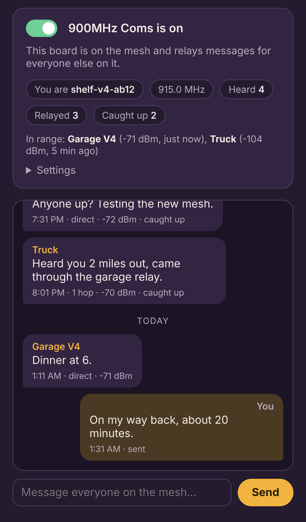</p>

- **On/off switch.** When it's on, the tab shows the message log and a box to send to everyone on the mesh (180 characters per message).
- **Every board is a relay.** Anything new a board hears, it re-sends once after a short random wait, so messages hop board to board as far as the mesh reaches (no hop limit). Message IDs are remembered so nothing loops, and boards listen before talking.
- **"Received" receipts.** A **✓ Sending "received"** button in the tab, on by default. When it's on, the board answers every message it hears with a short receipt that hops back to the sender, so your own messages show **✓ Received by Garage V4, Truck**. Click it to stop this board sending receipts. You'll still see receipts from boards that have theirs on.
- **Catch-up.** When a board turns Coms on, it asks its neighbors for the last 12 hours. One of them replays what it's missing (up to 60 messages), marked "caught up", with their original times.
- **Display.** The tab shows who's in range with signal strength, plus counts of heard, relayed and caught-up messages. The OLED shows an antenna icon while Coms is on, and new messages for 15 seconds.
- **Settings.** You can set your name on the mesh and the transmit power. On a V4: Low ~11 dBm, Normal ~20 dBm (default), or High ~27 dBm, through its front-end amplifier. On a V3: ~11, ~17 or ~22 dBm.
- **Boards on the mesh.** Every board says hello when Coms comes on and every 15 minutes, so the tab lists every board on the mesh, even ones several hops away: its name, V3 or V4, how many hops, battery, and when it was last heard. **Refresh** asks them all to answer now.
- **Manage a board remotely.** Click a board in the list, type its admin password, and **Connect**. See [Remote admin over 900MHz](#remote-admin-over-900mhz).
- **Air settings.** 915.0 MHz, 125 kHz, SF9, CR 4/5, private sync word 0x12. This is its own channel, separate from Meshtastic, which it doesn't talk to.

**Fit the LoRa antenna before switching Coms on.** Transmitting without an antenna can damage the radio. The log is kept on the card in `.shelf/data/coms-log.jsonl`.

#### How the mesh works

1. You type a message. Your board sends it once over the radio, after checking that nobody else is transmitting.
2. Every board that hears it adds it to its log, then re-sends it once after a random 0.4–2 second wait. That way boards don't all talk at the same moment.
3. Boards farther away hear those re-sends and do the same, so the message spreads board to board as far as the mesh reaches.
4. Each board remembers the last 1,024 message IDs. When a copy it already has comes back around, it ignores it, so nothing loops and each board sends each message only once.
5. In the log, a message shows **direct** if it came straight from the sender, or **N hops** if it was relayed, along with the signal strength it arrived at.
6. With receipts on, each board that gets a message waits 2–5 seconds (so the relays go first), then sends a tiny "received" packet. It hops back across the mesh the same way, and only the original sender keeps it. Each receipt is a few bytes, but every board sends one for every message, so on a big, busy mesh you can turn receipts off to save airtime.

#### Catching up a new board

When a board turns Coms on (or powers up with it on), it broadcasts a short "catch me up" request. The request lists the newest messages it already has.

1. Each board in range picks a random wait of 0.5–3 seconds. The first one to finish waiting answers.
2. The others hear it answering and stay quiet, so there's only one answer.
3. It replays up to 60 messages from the last 12 hours that the new board is missing, oldest first, about one every 1.2 seconds.
4. Each replay carries the message's age rather than a clock time, so it shows at the right time even if the boards' clocks disagree. Replays are marked **caught up** and aren't relayed further.

The request goes out again after 2 minutes in case nobody heard the first one.

### Remote admin over 900MHz

Manage any board on the mesh from any other, with no Wi-Fi or internet between them, all night if you like.

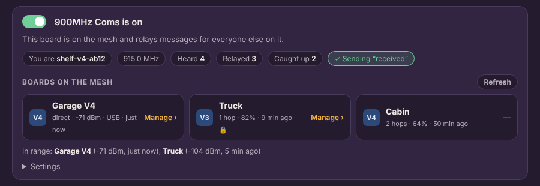

<p align="center">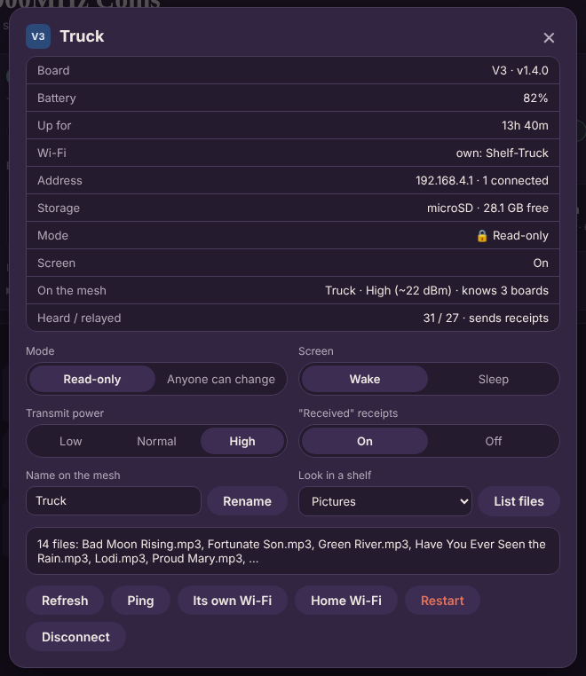</p>

1. On the board you want to manage, set an **admin password** on its settings page (`/board/`).
2. On any other board's Shelf, open **900MHz Coms** and click that board under **Boards on the mesh**. Boards without an admin password show **No password**.
3. Type its admin password and press **Connect**. Your board sends a request over the radio, and the panel fills in when the answer comes back: a few seconds when it's direct, a few more for each hop.

From the panel you can see its battery, uptime, Wi-Fi, address, storage, mode and screen, and you can:
- Turn **read-only** on or off
- **Wake** or **sleep** its screen
- Set its **transmit power** and **receipts**, and rename it on the mesh
- **List the files** in one of its shelves
- **Ping** it to check the path
- Switch it to **its own Wi-Fi** or back to **home Wi-Fi**
- **Restart** it

How it's kept safe:
- **Signed, not encrypted.** Commands and replies go over the air readable, as the amateur rules require, so anyone listening on 915 MHz can see them. Each one carries a signature (HMAC-SHA256) made from the target board's admin password. The password itself is never sent, and a board only obeys commands signed with its own password.
- **No replays.** Every command carries a number that has to be higher than the last one that board accepted, so a recorded command can't be played back later.
- **Wrong passwords.** After 5 wrong passwords in a row, a board refuses everything for 5 minutes.

Every board relays these requests and replies the same way as messages, so you can reach a board as far away as the mesh goes.

### Admin password and read-only mode

On the board's settings page, set an **admin password**. Then you can switch The Shelf to **read-only**:

- Everyone on the Wi-Fi can still browse, play music and videos, play games, read books, and chat in Messages and Coms.
- Nobody can upload, edit, rename, move or delete anything, or change the board's settings.
- A **Read-only** switch shows in The Shelf's sidebar. Tap it and enter the admin password to unlock **Write mode** in that browser for 8 hours. Tap it again to lock.
- If someone tries to change something while it's locked, the password box pops up for them.

<p align="center">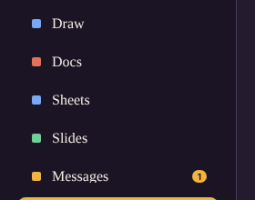 &nbsp; 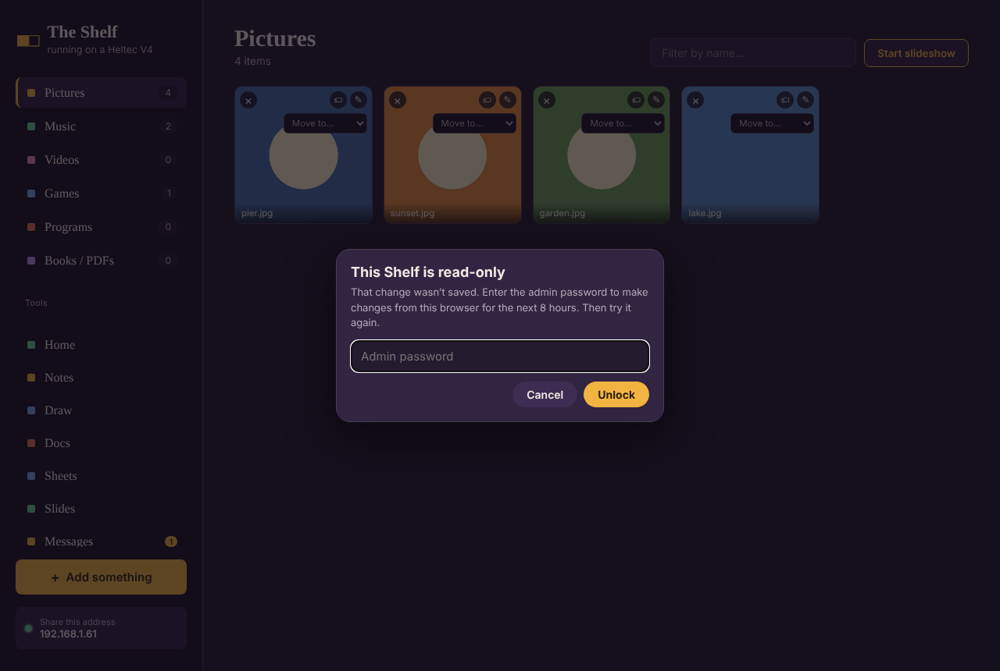</p>

You can turn read-only on or off remotely over 900MHz Coms too. The password isn't stored on the board, only a key made from it.

**Forgot it?** Hold the board's **PRG** button for 12 seconds. That clears the admin password and turns read-only off. You need the board in your hand to do it.

#### Turned off

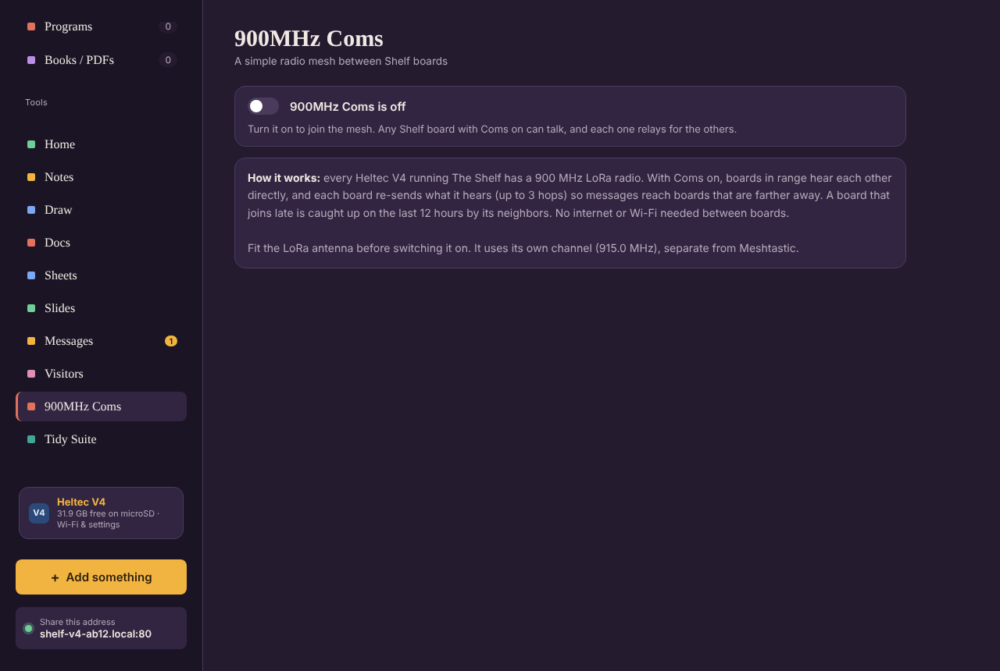

### Its own Wi-Fi (car, camping, anywhere)

On the settings page, choose **Use its own Wi-Fi**, then pick a network name and password. The board then runs its own network instead of joining yours, and The Shelf works fully on it. Join that network on your phone or laptop and open `http://192.168.4.1` (or `http://shelf-v4-xxxx.local`).

**Your phone keeps its cellular data.** The board's own network has no internet, and it says so. It hands out no gateway or DNS server, so an iPhone shows **"No Internet Connection"** under the network name. It stays joined for The Shelf (everything on 192.168.4.x) and sends everything else over cellular, so texts, iMessage, calls and apps keep working while you're connected. Android phones do the same. The only time the board acts as a sign-in page is first-time setup, for the minute or two it takes to pick your Wi-Fi. The board borrows the time from the first browser that opens it, so notes and files get the right dates. Messages with other Shelves needs your home Wi-Fi.

If the board is set to join your home Wi-Fi but can't find it at power-up, it starts its own Wi-Fi anyway and keeps looking for home.

<p align="center">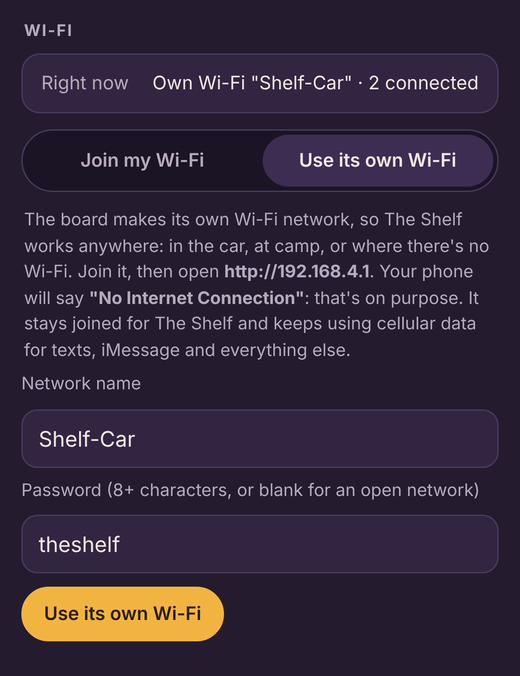</p>

### The screen

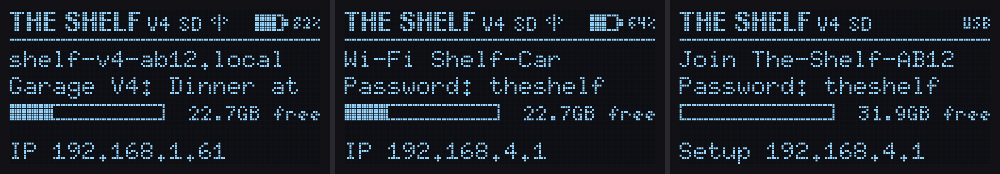

*Left to right: on your home Wi-Fi with a 900MHz Coms message showing, on its own Wi-Fi, and first power-up setup. These were drawn by the board's own screen code with the same U8g2 library and fonts, so they show what the OLED really draws, pixel for pixel.*

- **Top bar:** THE SHELF V4, SD or FLASH, an antenna icon while 900MHz Coms is on, and the **battery meter** with percent (`USB` when no battery is plugged in)
- **Line 1:** the board's name, or its own Wi-Fi network's name
- **Line 2:** nearby Shelves or Wi-Fi strength (on its own Wi-Fi: the password). New Coms messages show here for 15 seconds, and long ones scroll.
- **Storage bar** with free space
- **Bottom line:** the **IP address** to open

The screen goes dark after 5 minutes, even with The Shelf open in a browser. A short press of **PRG** wakes it, and so does **Wake** from a remote board over Coms.

The **Heltec V4** card at the bottom of The Shelf's sidebar opens the board's settings page (`/board/`). There you can change Wi-Fi, rename the board, see storage, and restart it. There's also the admin password and read-only switch.

**PRG button:** a short press wakes the screen. Hold it 6 seconds and let go to forget the Wi-Fi and go back to setup mode. Keep holding to 12 seconds to clear the admin password and turn read-only off.

## More screenshots

| | |
|:---:|:---:|
| 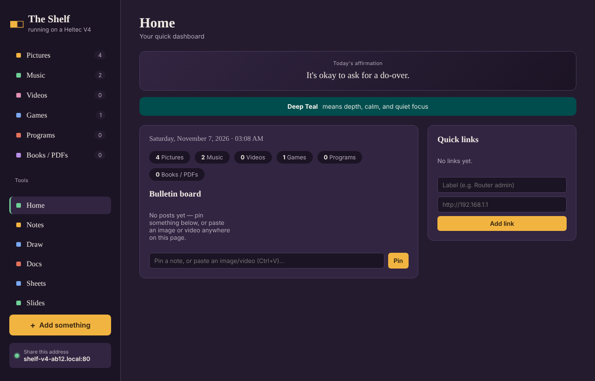 | 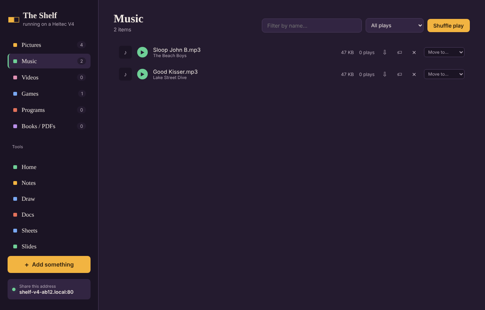 |
| **Home**: bulletin board, links, weather | **Music**: artists and art from your MP3s' tags |
| 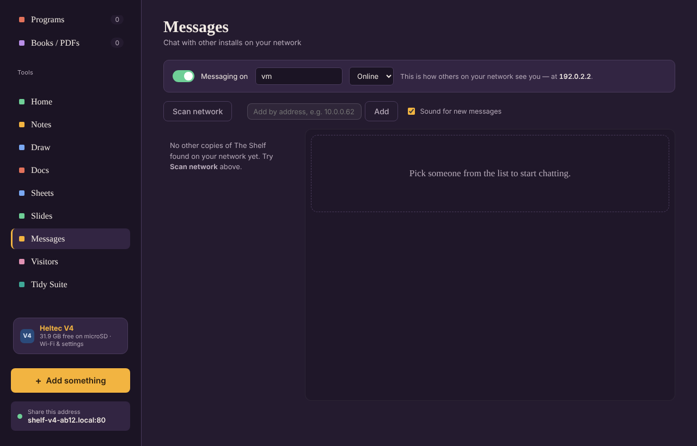 | 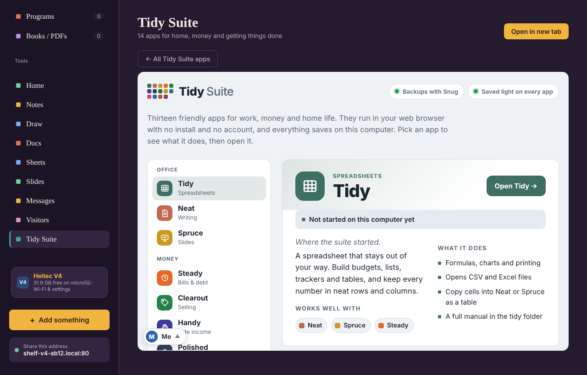 |
| **Messages** with your other Shelves | **Tidy Suite** |

*Screenshots use sample files and messages.*

## Messages between Shelves

The board talks to other Shelves the same way they talk to each other: `shelf-presence` broadcasts on UDP port 41234, a network scan that asks every address on port 8080 "are you a Shelf?", and direct HTTP for messages. That's why the board answers on **port 8080** as well as port 80. Click the board in another Shelf's Messages list to chat, or choose **Connect Shelf** to open it.

## Updates over Wi-Fi

From v1.9 the board has two firmware slots. On its settings page, **Update firmware** (or `http://<board>/update`) checks the [installer site](https://hardwaremack-prog.github.io/The-Shelf-Heltec-V4900mhzMesh/) for a newer version and installs it over Wi-Fi: the new firmware goes into the spare slot and the web app is rewritten, then the board restarts into it. Files, settings, Wi-Fi and the admin password stay. Without internet (the board's own Wi-Fi), pick the board's `-main.bin` from the installer page with **Update from a file**. The update page is built into the firmware, so it works even if a web-app update was cut off. Read-only mode blocks updates until write mode is unlocked.

> **Coming from v1.8 or earlier:** install v1.9 once over USB from the installer page. That one install changes the flash layout (adds the second slot), which clears files kept on the board's own flash; files on a microSD card are untouched.

`build.sh` also writes `docs/ota/<board>.json` plus gzipped `-app.bin.gz` and `-www.bin.gz` pieces, which is what the update page downloads.

## Plain ESP32 boards (NodeMCU-32S, ESP32-DevKitC)

The same Shelf runs on an ESP32-WROOM dev board with 4 MB of flash. Install it with **Install on ESP32** on the installer page (hold **BOOT** while connecting if the port won't open). What's different:

- **Its own Wi-Fi, no setup.** It has no screen, so it starts straight on its own network: **TheShelf32c**, password `theshelf`, at **http://10.1.1.250** (phones get 10.1.1.100 and up). Joining a home Wi-Fi is optional, from its settings page. Holding BOOT 6 s puts it back on TheShelf32c with the default password.
- **No 900MHz Coms** (no LoRa radio), and no Bluetooth: Wi-Fi and Bluetooth share one radio and too little memory on this chip, so Bluetooth is left off and its memory goes to the web server.
- **It needs a microSD card.** The 4 MB of flash holds The Shelf (2.3 MB slot), a small update loader (`ShelfLoader/`, 384 KB) and the web app, with the top 64 KB left empty (on some boards the chip's last sector doesn't keep what the installer writes). An update over Wi-Fi saves the new firmware on the card; the board restarts into the loader, which installs it and starts The Shelf again.
- **No screen or battery meter** unless you add an SSD1306 128×64 screen on GPIO 21 (SDA) / 22 (SCL), which it finds on its own. The BOOT button does what PRG does on a Heltec (hold 6 s: forget Wi-Fi; 12 s: clear the admin password).
- Its name on the network is `shelf-esp32-xxxx.local`; the setup Wi-Fi is `The-Shelf-XXXX` as usual.

| microSD module | ESP32 pin |
|---|---|
| 3v3 | 3V3 |
| GND | GND |
| CS | GPIO 5 |
| MOSI | GPIO 23 |
| CLK | GPIO 18 |
| MISO | GPIO 19 |

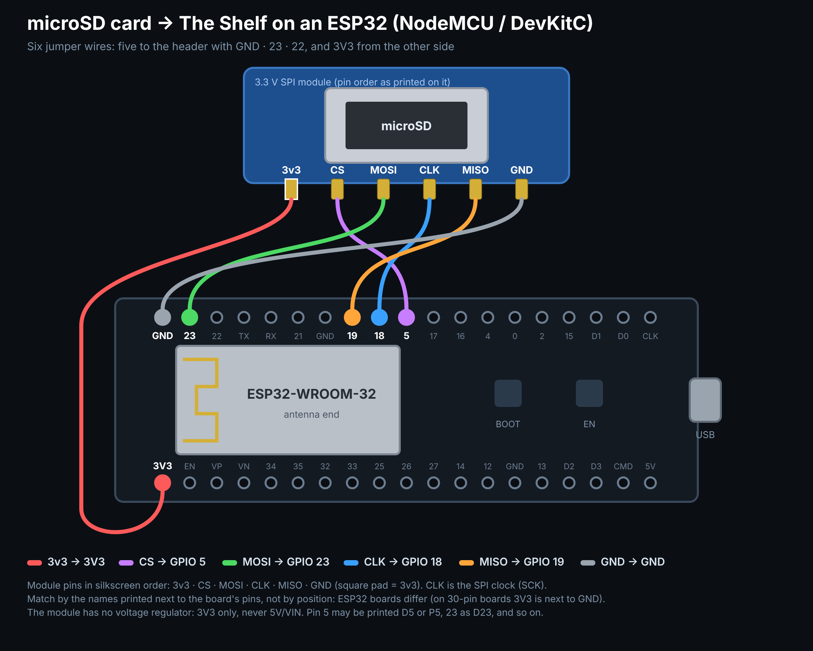

Wiring it with the board upside down (pins pointing up)? The rows swap places:

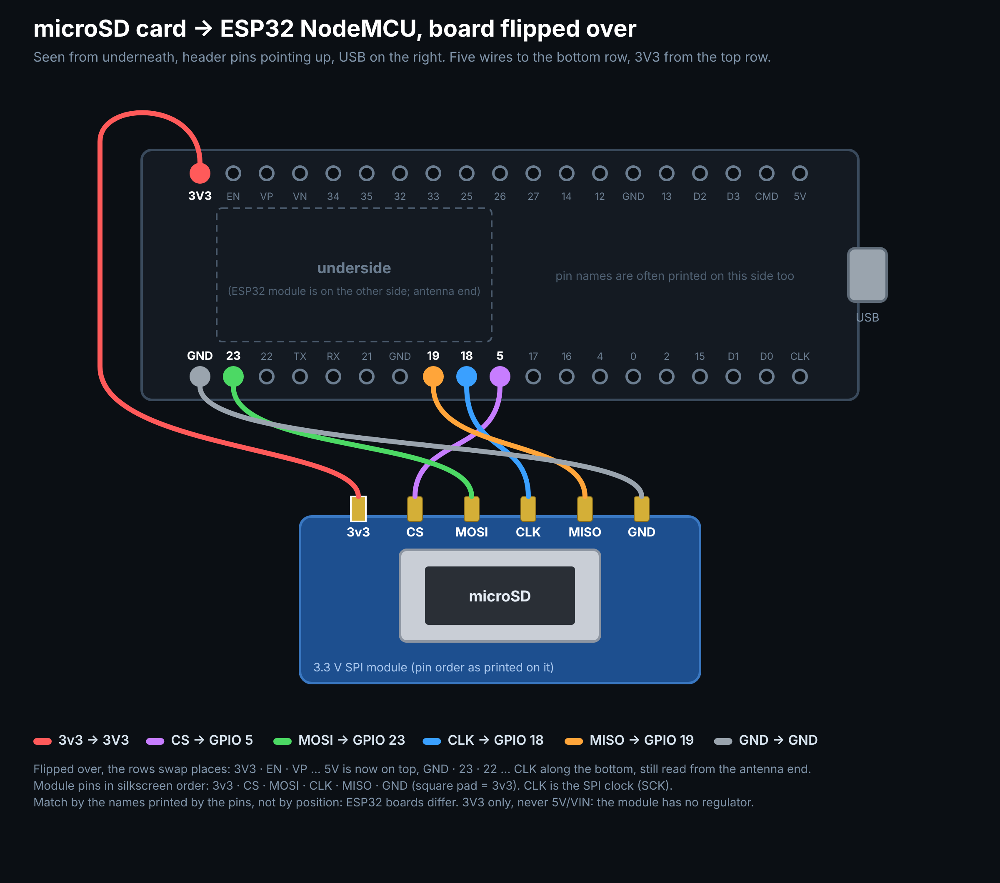

## Backups

- **The whole board, over USB.** On the [installer page](https://hardwaremack-prog.github.io/The-Shelf-Heltec-V4900mhzMesh/#backup), **Back up board** reads all of the board's flash (16 MB on a V4, 8 MB on a V3) into one `.bin.gz`: firmware, Wi-Fi, admin password, Coms history and any on-board files. **Restore from file** writes it back to the same board or a replacement of the same kind. Chrome or Edge on a computer.
- **The microSD card, over Wi-Fi.** On the board's settings page, **Back up card** saves every file on the card as one `.tar.gz` (7-Zip, Windows, macOS and Linux all open it). **Restore from a backup** puts the files back on this card or a new one, skipping any that are already there. Handy for moving to a bigger or newer card.

## Good to know

- **No accounts.** Anyone on your Wi-Fi can open it. Set an admin password and turn on read-only mode so only you can change things.
- Expect roughly 0.5–1 MB/s through the SPI card. Songs, photos, documents and games are quick; big videos are slow to upload.
- Weather needs the browser to share its location. Browsers only allow that on `https` or `localhost` pages, so on the board it usually stays hidden, the same as The Shelf does on a LAN.

## Building

`build.sh` packs The Shelf's current `public/` folder (cloned from [the-shelf](https://github.com/hardwaremack-prog/the-shelf), or set `SHELF=/path/to/the-shelf`) into a LittleFS image, compiles the firmware for both V4 versions, the V3 (`-DSHELF_V3`, `partitions/v3_8mb.csv`) and plain ESP32 boards (`-DSHELF_ESP32`, `partitions/esp32_4mb.csv`), and writes each as two pieces to `docs/firmware/`: `<name>-boot.bin` (bootloader and partition table, at 0x0) and `<name>-main.bin` (everything from 0xE000). Installing skips 0x9000–0xE000, where the board keeps its Wi-Fi and admin password, so a reinstall keeps them.

Needs:
- arduino-cli with **esp32 core 2.0.17**
- **ESPAsyncWebServer 3.3.23** + **AsyncTCP 3.2.14** (mathieucarbou), **ArduinoJson 7**, **U8g2**
- for the plain ESP32 build: **ESP32-A2DP 1.8** (pschatzmann) and **ESP8266Audio 1.9**
- **mklittlefs 3.x** built with `LFS_NAME_MAX=64` to match the board. The copy bundled with the 2.0.x core breaks on paths over 32 characters (`make CPPFLAGS="-D LFS_NAME_MAX=64"`, or edit its Makefile)

`tools/pack_www.py` makes a few changes to The Shelf's page for the board:
- removes the AI and Big Transfer tabs
- adds `board-ui/board.css`, which hides computer-only buttons
- adds `board-ui/board.js`, which shows the board card and its address

Rebuild after updating The Shelf to pick up its newest page.

### Layout

```
ShelfV4/
  main.cpp         Wi-Fi + setup mode, storage, web servers (80 and 8080), screen, button
  api_files.cpp    the six shelves: list, upload, rename, move, delete, play counts,
                   thumbnails, photo editor, zipped games, Range-capable file serving
  api_tools.cpp    Home board, Notes/Docs/Slides/Sheets, Draw, Visitors, weather, settings
  messaging.cpp    Shelf-to-Shelf discovery and chat
  coms.cpp         900MHz Coms: LoRa mesh, catch-up, receipts, hellos, signed remote admin
  admin.cpp        admin password, read-only mode, write-unlock cookies, signing keys
  music_meta.cpp   artist, title and cover art from ID3 tags
  util.cpp         JSON bodies (spooled to the card when big), streaming responses
board-ui/          the board's settings page and the small additions to The Shelf's page
                   (midi.js: MIDI playback, synth from MIDI Vault)
tools/pack_www.py  builds the web app image
docs/              web installer (GitHub Pages) and firmware
```

Flash layout (16 MB): 3 MB app, 2 MB web app (LittleFS), about 10.9 MB storage for when no card is fitted.
